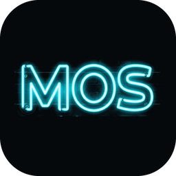

# VirtualMOS



MehburOS temalı, tarayıcıda çalışan sanal masaüstü. Kurulum gerektirmeden bilgisayarda, tablette ve telefonda açılır.

🔗 **Adres:** https://virtualmos.github.io/

> 🚧 **Durum:** Faz 1 (temel iskelet) tamamlandı: açılış animasyonu, MehburOS duvar kâğıtlı masaüstü, Türkçe/İngilizce.
> Pencereler ve uygulamalar sonraki fazlarda geliyor. Plan için: [yol haritası](docs/yol-haritasi.md).

## Neler olacak?

- MehburOS'un neon camgöbeği–siyah temasında masaüstü: pencereler, alt panel, uygulama menüsü, bildirimler
- Dokunmatik dostu arayüz: tablet modu (iki uygulama yan yana) ve telefon modu
- Dosyaların cihazda gerçek bir klasöre kaydedilmesi (desteklemeyen tarayıcılarda tarayıcı depolaması)
- Uygulamalar: Dosyalar, metin düzenleyici, hesap makinesi, çizim, fotoğraflar, terminal, tarayıcı, ayarlar ve MehburMC Launcher demosu
- Türkçe ve İngilizce

## Geliştirme

Gerekenler: [Node.js](https://nodejs.org/) 22 veya üstü ve [pnpm](https://pnpm.io/).

```bash
git clone https://github.com/virtualmos/virtualmos.github.io.git
cd virtualmos.github.io
pnpm install
pnpm dev          # geliştirme sunucusu: http://localhost:5173
```

| Komut | Ne yapar |
|---|---|
| `pnpm dev` | Geliştirme sunucusunu açar; dosya kaydedince sayfa kendiliğinden yenilenir |
| `pnpm build` | Tip kontrolü yapar ve yayınlanacak dosyaları `dist/` klasörüne üretir |
| `pnpm preview` | `dist/` klasöründeki derlenmiş siteyi yerelde açar |
| `pnpm lint` | Kod hatalarını ve kötü alışkanlıkları ESLint ile arar |
| `pnpm format` | Kodu Prettier ile düzenli biçime sokar |
| `pnpm test` | Birim testleri çalıştırır (Vitest) |
| `pnpm test:e2e` | Siteyi gerçek tarayıcıda bilgisayar, tablet ve telefon boyutlarında test eder (Playwright). İlk seferde `pnpm exec playwright install chromium` gerekir |
| `pnpm check` | Lint + biçim + tip + birim test, hepsi bir arada |

## Yayınlama

Elle bir şey yapmaya gerek yok. GitHub Actions ([.github/workflows/ci.yml](.github/workflows/ci.yml)):

- **Her PR'da:** lint, biçim, birim test, derleme ve tarayıcı testlerini çalıştırır.
- **main'e merge edilince:** aynı kontrollerden geçerse siteyi GitHub Pages'e yayınlar.

## Dosya yapısı

| Yol | Açıklama |
|---|---|
| `index.html` | Sayfanın giriş noktası |
| `src/main.tsx` | Uygulamayı başlatır |
| `src/App.tsx` | Açılış ekranı → masaüstü geçişi |
| `src/shell/` | Masaüstü kabuğu (açılış ekranı, masaüstü; ileride panel ve pencere yöneticisi) |
| `src/apps/` | Uygulamalar (Faz 4'ten itibaren) |
| `src/i18n/` | Türkçe/İngilizce metinler ve dil seçimi |
| `src/styles/tokens.css` | Tema renkleri ve ölçüleri (MehburOS renkleri) |
| `src/assets/wallpapers/` | Duvar kâğıtları (16:9 ve 4:3, WebP) |
| `public/` | Olduğu gibi kopyalanan dosyalar: logo, 404 sayfası |
| `e2e/` | Tarayıcı testleri (Playwright) |
| `docs/yol-haritasi.md` | Kararlar ve fazlar |

## Kullanılan teknolojiler

- [Vite](https://vite.dev/): geliştirme sunucusu ve derleme
- [React](https://react.dev/) + [TypeScript](https://www.typescriptlang.org/)
- ESLint + Prettier, Vitest + Testing Library, Playwright
- GitHub Actions + GitHub Pages

## Eski sürüm (Win11 Web)

Bu proje önce **Win11 Web** adıyla, Windows 11 görünümlü bir simülasyon olarak yayınlanmıştı. Son hali `v0.1.0-win11` etiketinde duruyor:

```bash
git checkout v0.1.0-win11
python -m http.server 8000   # ardından http://localhost:8000
```
