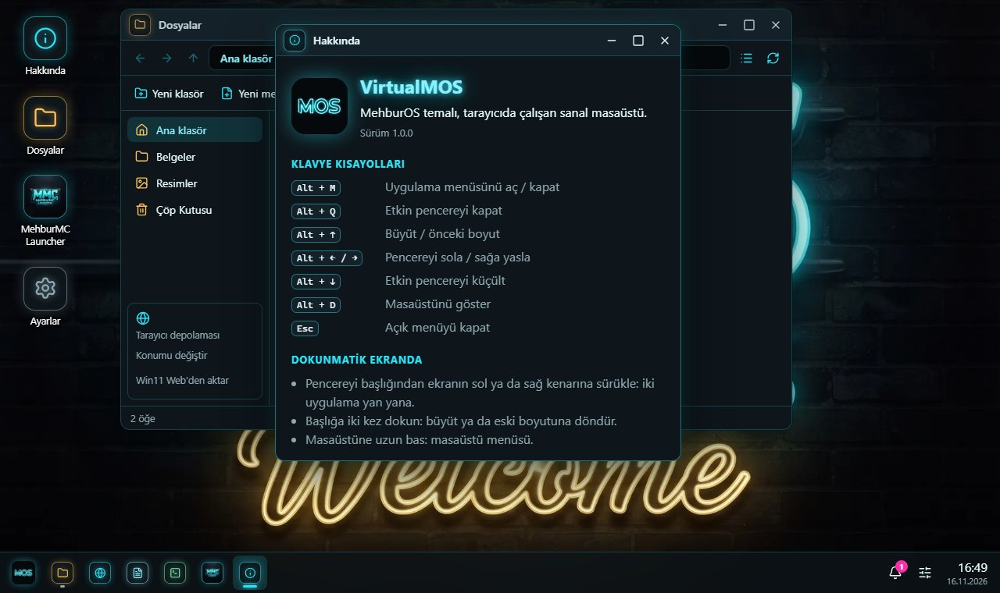

# VirtualMOS


MehburOS temalı, tarayıcıda çalışan sanal masaüstü. Kurulum gerektirmeden bilgisayarda, tablette ve telefonda açılır.

🔗 **Adres:** https://virtualmos.github.io/ · 📦 **Sürüm:** 1.0.0 ([değişiklikler](CHANGELOG.md))



## Özellikler

- MehburOS'un neon camgöbeği–siyah temasında masaüstü: sürüklenip boyutlandırılabilen, kenara yaslanabilen pencereler, alt panel, aramalı uygulama menüsü, bildirimler, saat/takvim ve hızlı ayarlar
- Dokunmatik dostu: tablette iki uygulama yan yana, telefonda uygulamalar tam ekran
- Dosyalar cihazında gerçek bir klasöre kaydedilir (desteklemeyen tarayıcılarda tarayıcının bu cihazdaki alanına)
- 10 uygulama: Dosyalar, Metin Düzenleyici, Hesap Makinesi, Çizim, Fotoğraflar, Terminal, Tarayıcı, Ayarlar, Hakkında ve MehburMC Launcher demosu
- Ana ekrana eklenebilir, internet olmadan da açılır
- Türkçe ve İngilizce, açık ve koyu tema

## Ana ekrana ekle, internetsiz kullan

VirtualMOS bir **PWA**'dır (kurulabilen web uygulaması). Siteyi bir kez açınca dosyaları cihaza önbelleğe alınır ve
**"İnternetsiz kullanıma hazır"** bildirimi çıkar; bundan sonra internet olmadan da açılır.

| Cihaz | Nasıl eklenir |
|---|---|
| Bilgisayar (Edge, Chrome) | Adres çubuğundaki **Uygulamayı yükle** simgesi |
| Android (Chrome) | ⋮ menü → **Ana ekrana ekle** / **Uygulamayı yükle** |
| iPad, iPhone (Safari) | Paylaş → **Ana Ekrana Ekle** |

Yeni bir sürüm yayınlandığında **"Yeni sürüm hazır"** bildirimi çıkar; **Yenile**'ye basınca güncellenir (kendiliğinden yenilenmez, açık işlerin kaybolmasın diye).
İnternetsizken Tarayıcı'daki siteler ve Launcher'daki sürüm bilgisi gelmez.

## Dosyalar nerede saklanır?

Pencereler ve uygulamalar tamamen sitede çalışır; oluşturduğun dosyalar ise cihazına yazılır. İlk açılışta sorulur, sonradan **Ayarlar → Depolama** ya da **Dosyalar → Konumu değiştir** ile değiştirilebilir (eski yerdeki dosyalar yeni yere kopyalanır).

| Seçenek | Nasıl çalışır | Tarayıcılar |
|---|---|---|
| 📁 **Cihazımda klasör** | Seçtiğin yerde (ör. Belgeler) `VirtualMOS` adlı gerçek bir klasör oluşturulur; dosyalar cihazın dosya yöneticisinde de görünür | Chrome, Edge, Opera (bilgisayar), Android Chrome |
| 🌐 **Tarayıcıda** | Dosyalar bu cihazda, tarayıcının siteye ayırdığı alanda (OPFS, yoksa IndexedDB) durur; **İndir** ile cihaza alınır | Tüm modern tarayıcılar (iPhone/iPad ve Firefox dahil) |

- Tarayıcı klasör iznini unutursa açılışta **İzin ver** penceresi çıkar.
- Silinen öğeler `.trash` adlı gizli klasöre (Çöp Kutusu) gider; oradan geri yüklenebilir.
- Eski **Win11 Web** dosyaların için: Dosyalar → **Win11 Web'den aktar** → eski `Win11 Web` klasörünü seç.

## Kullanım ipuçları

| Nerede | Ne yapılır |
|---|---|
| Bilgisayar | Pencereyi başlığından ekranın sol/sağ kenarına sürükle → yarım ekran; üst kenara → tam ekran. Masaüstüne sağ tık → menü |
| Tablet | Aynı sürükleme dokunmatikle de çalışır; pencere başlığındaki **yan yana** düğmesi sola/sağa yaslar |
| Telefon | Uygulamalar tam ekran açılır; masaüstü ana ekran gibi tüm uygulamaları gösterir |
| Klavye | `Alt+M` menü, `Alt+Q` kapat, `Alt+↑` büyüt, `Alt+←/→` yasla, `Alt+↓` küçült, `Alt+D` masaüstü, `Esc` menüyü kapat |

## Uygulamalar

| Uygulama | Ne yapar |
|---|---|
| Dosyalar | Klasörler, kopyala/kes/yapıştır, Çöp Kutusu, cihazdan ekleme, indirme, önizleme |
| Metin Düzenleyici | Metin dosyası yazar, kaydeder (`Ctrl+S`); Dosyalar'dan çift tıkla açılır |
| Hesap Makinesi | Dört işlem, yüzde, klavyeden kullanım |
| Çizim | Kalem, silgi, şekiller, boya kovası; PNG olarak Resimler'e kaydeder |
| Fotoğraflar | Resimler klasöründeki fotoğrafları gösterir, aralarında gezinir |
| Terminal | MehburOS komutları: `help`, `ls`, `cd`, `cat`, `mkdir`, `open`, `theme`, `neofetch`… |
| Tarayıcı | Siteleri pencere içinde açar (izin vermeyen siteler ↗ ile gerçek tarayıcıda açılır) |
| Ayarlar | Tema, vurgu rengi, duvar kâğıdı, dil ve dosyaların saklandığı yer |
| MehburMC Launcher | Gerçek launcher'ın arayüzünü taklit eden demo: profiller, haberler, yenilikler. En güncel sürüm GitHub Releases'ten okunur, Windows/Linux için gerçek indirme bağlantıları verilir. **Oyna** düğmesi demo olduğunu söyler (tarayıcıdan Minecraft başlatılamaz) |

## Geliştirme

Gerekenler: [Node.js](https://nodejs.org/) 22 veya üstü ve [pnpm](https://pnpm.io/).

```bash
git clone https://github.com/virtualmos/virtualmos.github.io.git
cd virtualmos.github.io
pnpm install
pnpm dev          # geliştirme sunucusu: http://localhost:5173
```

| Komut | Ne yapar |
|---|---|
| `pnpm dev` | Geliştirme sunucusunu açar; dosya kaydedince sayfa kendiliğinden yenilenir |
| `pnpm build` | Tip kontrolü yapar ve yayınlanacak dosyaları `dist/` klasörüne üretir |
| `pnpm preview` | `dist/` klasöründeki derlenmiş siteyi yerelde açar |
| `pnpm lint` | Kod hatalarını ve kötü alışkanlıkları ESLint ile arar |
| `pnpm format` | Kodu Prettier ile düzenli biçime sokar |
| `pnpm test` | Birim testleri çalıştırır (Vitest) |
| `pnpm test:e2e` | Siteyi gerçek tarayıcıda bilgisayar, tablet ve telefon boyutlarında test eder (Playwright). İlk seferde `pnpm exec playwright install chromium` gerekir |
| `pnpm check` | Lint + biçim + tip + birim test, hepsi bir arada |

## Yayınlama

Sürüm numarası `package.json`'daki `version` alanından gelir ve **Hakkında** penceresinde görünür. Siteyi yayınlamak için elle bir şey yapmaya gerek yok. GitHub Actions ([.github/workflows/ci.yml](.github/workflows/ci.yml)):

- **Her PR'da:** lint, biçim, birim test, derleme ve tarayıcı testlerini çalıştırır.
- **main'e merge edilince:** aynı kontrollerden geçerse siteyi GitHub Pages'e yayınlar.

## Dosya yapısı

| Yol | Açıklama |
|---|---|
| `index.html` | Sayfanın giriş noktası |
| `src/main.tsx` | Uygulamayı başlatır |
| `src/App.tsx` | Açılış ekranı → masaüstü geçişi, yeniden başlatma |
| `src/shell/` | Masaüstü kabuğu: açılış ekranı, masaüstü, simgeler, sağ tık menüsü, cihaz modu (`device.ts`) |
| `src/shell/wm/` | Pencere yöneticisi: durum (`reducer.ts`), konum hesapları (`geometry.ts`), pencere bileşeni |
| `src/shell/panel/` | Alt panel, uygulama menüsü, hızlı ayarlar, takvim |
| `src/shell/notifications/` | Bildirimler ve köşede beliren bildirim kutuları |
| `src/apps/` | Uygulamalar ve uygulama listesi (`registry.ts`); her uygulamanın kodu ilk açıldığında indirilir |
| `src/pwa/` | İnternetsiz açılış: service worker şablonu (`sw-template.js`) ve kaydı/güncelleme bildirimi (`usePwa.ts`) |
| `vite-pwa-plugin.ts` | Derlemede `dist/sw.js` üretir: önbelleğe alınacak dosya listesi + sürüm |
| `src/apps/files/` | Dosyalar uygulaması |
| `src/apps/<uygulama>/` | Diğer uygulamalar: `editor`, `calculator`, `paint`, `photos`, `terminal`, `browser`, `settings`; ortak parçalar `shared/`, dosyayı uygun uygulamayla açma `openWith.ts` |
| `src/apps/launcher/` | MehburMC Launcher demosu: sayfalar, sürüm bilgisi (`releases.ts`, GitHub Releases + 10 dk önbellek), profiller (`profiles.ts`), sürüm notu okuyucu (`notes.ts`) |
| `src/storage/` | Depolama katmanı: cihaz klasörü/OPFS (`handleBackend.ts`), IndexedDB/bellek (`recordBackend.ts`), dosya işlemleri (`fileOps.ts`), yer seçimi (`manager.ts`) |
| `src/shell/dialog/` | Soru ve onay pencereleri |
| `src/settings/` | Tema (açık/koyu), vurgu rengi ve duvar kâğıdı tercihleri |
| `src/i18n/` | Türkçe/İngilizce metinler ve dil seçimi |
| `src/styles/tokens.css` | Tema renkleri ve ölçüleri (MehburOS renkleri) |
| `src/assets/wallpapers/` | Duvar kâğıtları (16:9 ve 4:3, WebP) |
| `public/` | Olduğu gibi kopyalanan dosyalar: logo ve uygulama simgeleri, `manifest.webmanifest`, 404 sayfası |
| `e2e/` | Tarayıcı testleri (Playwright); `a11y.spec.ts` erişilebilirlik taraması (axe-core), `pwa.spec.ts` internetsiz açılış |
| `docs/yol-haritasi.md` | Kararlar ve fazlar |
| `docs/cihaz-testi.md` | Gerçek cihazlarda elle deneme listesi |
| `docs/ekran-goruntusu.jpg` | README'deki ekran görüntüsü |

## Kullanılan teknolojiler

- [Vite](https://vite.dev/): geliştirme sunucusu ve derleme
- [React](https://react.dev/) + [TypeScript](https://www.typescriptlang.org/)
- [Lucide](https://lucide.dev/) simgeleri
- ESLint + Prettier, Vitest + Testing Library, Playwright
- GitHub Actions + GitHub Pages

## Eski sürüm (Win11 Web)

Bu proje önce **Win11 Web** adıyla, Windows 11 görünümlü bir simülasyon olarak yayınlanmıştı. Son hali `v0.1.0-win11` etiketinde duruyor:

```bash
git checkout v0.1.0-win11
python -m http.server 8000   # ardından http://localhost:8000
```
